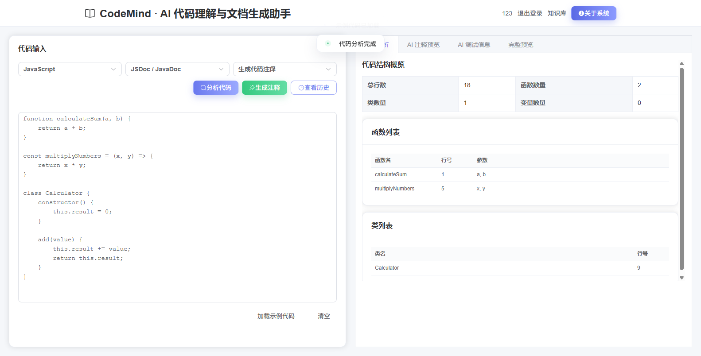
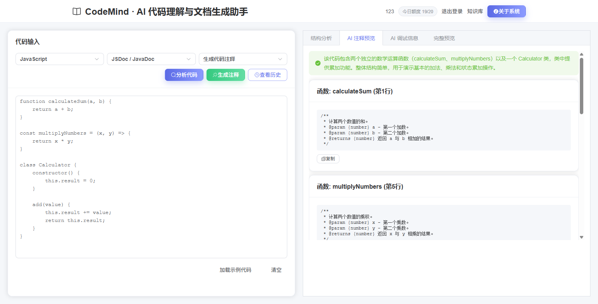
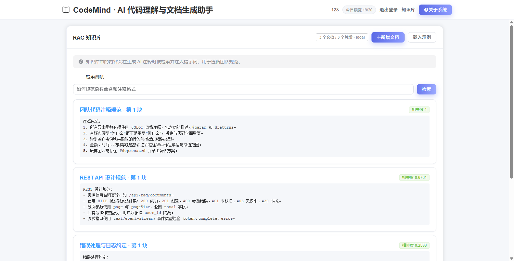
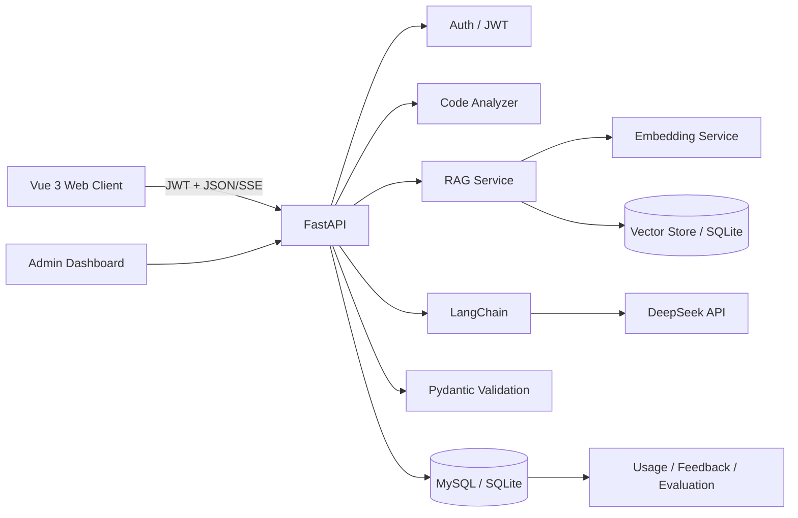

# CodeMind｜AI 代码理解与文档生成助手

[](https://github.com/SYM529/codemind/actions/workflows/ci.yml)

CodeMind 是一个基于 DeepSeek 的 AI 代码理解与文档生成助手，结合 Python AST、LangChain、RAG 检索增强、结构化输出校验和可观测性，支持代码注释、代码解释、重构建议、历史管理和多用户数据隔离。

后端驱动完整生成流水线：代码结构分析 → 语义缓存 → BM25+向量混合检索 → Prompt 组装 → SSE 逐 token 流式生成 → JSON 清洗与 Pydantic 结构化校验；前端提供代码工作台、RAG 知识库、项目理解与多用户数据隔离；`tests/` 提供 108 项 SQLite/MySQL 双驱动测试，GitHub Actions 自动执行。

开发周期：2026-08 至 2026-10 持续开发，2026-10 统一推送至 GitHub。

**在线演示**：http://124.220.135.176:8081 —— 部署于腾讯云轻量服务器（Docker Compose 三容器：Nginx / FastAPI / MySQL 8），公网可访问（注册已关闭，如需试用账号可通过简历联系方式获取）。

代码结构、生成质量与成本的真实运行数据见下文「测试与质量评估」；开发部署过程中的问题复盘见 [docs/TROUBLESHOOTING.md](docs/TROUBLESHOOTING.md)。

## 界面预览

**代码结构分析**（Python AST / 多语言解析，自动识别函数、类、变量与行号）：



**AI 生成 JSDoc 注释**（SSE 流式生成 + Pydantic 结构化校验）：



**RAG 知识库**（文档分块向量化，BM25 + 向量混合检索与词面重排，相关度排序）：



## 项目概述

这是一个面向 AI 应用开发的全栈项目，重点展示 LLM 调用编排、RAG 检索增强、流式响应、结构化结果校验、质量评估、成本控制、JWT 鉴权和 MySQL/SQLite 双驱动持久化等工程能力。

开发周期：2026-08 至 2026-10 持续开发，2026-10 统一整理后推送至 GitHub。

## 快速体验（3 分钟）

```bash
git clone https://github.com/SYM529/codemind.git
cd codemind
# 参考 server_py/.env.example 创建 server_py/.env，至少填写：
#   DEEPSEEK_API_KEY=sk-xxxx          # DeepSeek 密钥
#   JWT_SECRET=一段随机长字符串       # 登录令牌签名密钥
#   MYSQL_PASSWORD / MYSQL_ROOT_PASSWORD   # compose 内置 MySQL 口令
docker compose up -d --build
```

打开 http://localhost:8080 即可使用：注册 → 载入知识库示例 → 粘贴代码生成注释。MySQL 8 由 compose 编排（数据落在 mysql-data 卷持久化）；想零配置本地跑（SQLite），见下文「安装和运行」。

### 已知局限（摘要）

- 向量检索为全量内存精确检索，无 ANN 索引，面向数百到数千 chunk 规模
- 语义缓存阈值 0.98 偏保守，命中率低但优先保证正确性
- IP 限流为单机内存态，重启即失效、多实例不共享
- 项目索引任务为进程内后台线程（无独立队列），进程重启会丢失进行中的任务，多实例不共享任务状态

> 均属小规模（个人/团队）场景下的主动设计取舍，详见下文「已知限制与演进路线」。

## 系统特性

- 🤖 **智能注释生成** - 基于 LLM 与代码结构分析自动生成函数级注释
- 📚 **RAG 知识库** - 上传规范文档/参考代码，生成时向量检索并注入上下文
- 📦 **项目级代码理解** - 上传整个项目的 ZIP 压缩包，多文件扫描 + 结构解析，建立与项目隔离的知识库
- 🔎 **混合检索** - BM25 + 向量召回 + 词面重排，提升知识命中质量
- ♻️ **语义缓存** - 相似请求命中缓存直接复用结果，跳过模型调用降低成本
- 🌐 **多语言支持** - JavaScript/TypeScript、Python（AST）、Java（专用正则解析，含构造器/泛型方法/字段）
- 📊 **代码结构分析** - Python AST 与多语言正则解析自动识别函数、类、变量、import 等元素
- 🎯 **实时预览** - 即时查看生成的注释效果
- 📚 **历史管理** - AI 生成历史记录与分页查询
- 🌐 **现代化界面** - 基于 Vue3 + Element Plus 的响应式界面，路由懒加载
- ⚡ **流式生成** - 通过 SSE 逐 token 实时接收模型响应
- 🔐 **用户与权限** - JWT 登录、用户数据隔离、管理员看板
- 📈 **可观测性** - 真实 Token、耗时、成本、质量指标、RAG 命中和缓存状态
- 🛡️ **资源控制** - 代码长度、IP 限流、登录限流和每日 AI 额度限制

## 技术栈

### 后端
- Python 3.10+ / FastAPI + Uvicorn
- LangChain + DeepSeek API（OpenAI 兼容接口）
- RAG：本地哈希 n-gram Embedding（可切换 OpenAI 兼容 Embedding API）+ NumPy 向量检索
- Python `ast` / 正则代码结构分析
- 双驱动数据层：生产使用 MySQL 8（PyMySQL + DBUtils 连接池），本地开发零配置回退 SQLite（文档、片段、向量、历史、用量）
- PyJWT + bcrypt 用户认证
- Pydantic 结构化输出校验
- CORS 跨域支持

### 前端
- Vue 3 + Vue Router + Vuex
- Element Plus UI 组件库
- Axios HTTP 客户端 + Fetch SSE 流式接收

## 项目结构

```
codemind/
├── server_py/                     # Python 后端服务
│   ├── main.py                    # FastAPI 入口
│   ├── config.py                  # 环境变量与安全校验
│   ├── database.py                # 双驱动数据层：MySQL（PyMySQL 连接池）/ SQLite 建表与迁移
│   ├── auth.py                    # JWT 签发/校验、密码哈希、权限
│   ├── rate_limit.py              # 通用滑动窗口限流器
│   ├── http_errors.py             # 统一 HTTP 错误响应
│   ├── models.py                  # Pydantic 请求/响应模型
│   ├── routes/                    # 路由层
│   │   ├── auth.py                # 注册/登录/改密/注销
│   │   ├── ai.py                  # AI 生成/SSE/额度/历史/反馈/缓存
│   │   ├── rag.py                 # 知识库 CRUD/检索
│   │   ├── admin.py               # 管理员看板
│   │   └── projects.py            # 项目上传/解析进度/文件清单/项目问答
│   ├── services/                  # 业务服务层
│   │   ├── ai_comment_service.py  # LangChain + DeepSeek 调用
│   │   ├── code_analyzer.py       # Python AST / JS / Java 结构分析
│   │   ├── code_chunker.py        # 按符号边界切片，超长退化为行/字符窗口
│   │   ├── archive_service.py     # ZIP 安全解包与文件筛选
│   │   ├── project_service.py     # 项目生命周期、后台索引编排、工作目录清理
│   │   ├── ai_qa_service.py       # 项目级问答的 Prompt 与流式生成
│   │   ├── nlp_comment_generator.py # 规则版注释生成
│   │   ├── embedding_service.py   # 向量化
│   │   ├── rag_service.py         # 分块/索引/混合检索/重排
│   │   ├── cache_service.py       # 语义缓存
│   │   ├── evaluation_service.py  # 质量评估
│   │   ├── feedback_service.py    # 反馈
│   │   ├── usage_service.py       # 用量与成本
│   │   └── generation_history_service.py
│   ├── tests/                     # pytest 单测与 API 集成测试（鉴权/RBAC/隔离/级联/ZIP 安全/迁移/问答）
│   ├── conftest.py                # 测试配置（SQLite 临时库 / MySQL 测试库）
│   ├── requirements.txt / requirements-dev.txt
│   ├── .env.example               # 环境变量模板
│   └── Dockerfile
├── client/                        # 前端应用
│   ├── src/
│   │   ├── api/                   # API 封装
│   │   ├── router/                # 路由配置（懒加载）
│   │   ├── store/                 # 状态管理
│   │   ├── components/            # 可复用组件（AuthShell、DebugPanel 等）
│   │   ├── views/                 # 页面组件（Home/Knowledge/Project/History/Admin 等）
│   │   ├── App.vue
│   │   └── main.js
│   ├── nginx.conf                 # 生产 Nginx（gzip / 缓存 / API 反代）
│   └── package.json
├── .github/workflows/ci.yml       # 后端双驱动测试 + 前端 lint/构建
├── docker-compose.yml             # Nginx + FastAPI + MySQL 8 编排
└── README.md
```

## 系统架构



## AI 生成流程（含 RAG 与缓存）

```text
用户输入代码
  -> 输入长度与每日额度校验
  -> 代码结构分析（AST / 正则）
  -> 语义缓存查询（签名向量相似度命中则直接返回，跳过模型）
  -> 构造检索查询（语言 + 任务 + 函数名 + 代码片段）
  -> 混合检索知识库（BM25 + 向量召回 + 词面重排）top-k 片段
  -> LangChain Prompt 编排（注入检索上下文）
  -> DeepSeek 逐 token 流式生成
  -> JSON 清洗、字段标准化和 Pydantic 校验（含数组/围栏容错）
  -> 质量评估（函数覆盖率、行号有效率）
  -> 保存历史、真实 Token、成本、RAG 命中、缓存状态和反馈
  -> 前端展示结果
```

## 项目亮点与技术难点

1. **RAG 混合检索**：文档分块向量化存入数据库，检索时融合 BM25 与向量相似度并做词面重排；默认零依赖本地哈希 n-gram Embedding，可通过环境变量切换为 OpenAI 兼容 Embedding API；入库与检索均校验向量维度一致性，切换 Embedding 模式导致维度不一致时显式报错提示重建索引，避免知识库静默失效。
2. **项目级代码理解**：上传项目 ZIP 后安全解包并建立项目知识库——拒绝路径穿越与符号链接、过滤依赖目录与密钥文件、四重体积上限且在写入过程中按实际字节复核；按符号边界切片（Python 取 AST 起止行，其余语言按大括号深度识别类方法），Chunk 带来源文件、符号名与行号区间；检索按 `project_id` 隔离，项目问答只引用真实命中的片段，检索不到依据时明确拒答而不是编造项目结构。
3. **语义缓存**：对请求签名做向量相似度匹配，命中则复用历史结果并跳过模型调用，缓存键包含知识库版本，避免上下文变化导致结果过期。
4. **真实 Token 计量**：开启 `stream_usage`，从模型响应读取真实 `usage`，流式与非流式均记录真实输入/输出 Token 与成本（不可用时回退估算并标注来源 `api`/`estimated`/`cache`），用量接口按来源聚合，估算/真实口径不硬编码。
5. **DeepSeek 兼容性处理**：采用"流式文本接收 + JSON 清洗 + Pydantic 校验"，并容忍模型返回顶层数组或 Markdown 围栏。
6. **AI 结果可评估**：计算函数覆盖率和行号有效率，保存每次生成的质量评估结果。
7. **成本与安全**：按用户记录 Token 和成本，IP 限流、登录/注册限流、代码长度限制、每日调用额度和 CORS 白名单。
8. **数据安全隔离**：生成历史、反馈、使用量、评估、缓存和知识库数据都通过 `user_id` 隔离，注销账户时级联删除。
9. **工程化**：pytest 单元测试与 API 集成测试（未鉴权 401、越权 403、跨用户数据隔离、注销级联删除、Embedding 维度防护、未配置 Key 时 503 降级），CI 同时覆盖 SQLite 与 MySQL 双驱动；GitHub Actions（后端双驱动测试 + 前端 lint/构建）、Docker Compose 三容器编排（Nginx + FastAPI + MySQL 8，数据库仅内网可达）。

> 📋 开发与部署过程中的真实问题复盘（MySQL 方言适配 Bug、SSE 异常吞噬、配置验证方法等 7 个案例）见 [docs/TROUBLESHOOTING.md](docs/TROUBLESHOOTING.md)。

## 测试与质量评估

**评测定位**：CodeMind 的质量评测是**在线、逐次、持续**的——每次生成自动计算函数覆盖率与行号有效率并落库，随真实使用持续累积，展示的是真实运行数据，而非离线批量构建的评测集。它回答的是「上线后每次生成质量如何」；离线批量评测（人工构建评测集做 CI 回归门禁）回答的是「上线前整体能力如何」。两者是互补的两种评测形态，而非同一维度的替代。

**108 项 pytest 测试**（本地 `python -m pytest -q` 运行，共收集 109 项，其中 1 项 MySQL 专用用例在 SQLite 轮次自动跳过），覆盖：未鉴权 401、越权 403、跨用户数据隔离、注销级联删除、Embedding 维度一致性防护、未配置 Key 时 503 降级，以及 ZIP 安全边界（路径穿越／压缩炸弹／符号链接／体积上限）、项目检索隔离、旧库增量迁移与问答引用链路。CI 同时在 SQLite 与 MySQL 双驱动上执行（GitHub Actions，状态见页首徽章）。

测试分布：

| 测试文件 | 用例数 | 覆盖重点 |
| --- | --- | --- |
| `test_archive_service.py` | 32 | ZIP 安全边界：路径穿越、压缩炸弹、符号链接、敏感文件、四类体积上限 |
| `test_projects_api.py` | 14 | 项目上传/清单/删除、跨用户隔离、越权 404、级联、限流与超限 |
| `test_code_chunker.py` | 8 | 符号边界切片、嵌套符号递归、行号区间不重叠、长度上限与兜底 |
| `test_project_qa.py` | 8 | 证据不足不调模型、引用回传真实来源、跨项目上下文隔离、流式事件 |
| `test_database_migration.py` | 5 | 旧库补列补索引、迁移幂等性、迁移与建表 DDL 一致性（含 1 项 MySQL 专用用例） |
| `test_ai_comment_service.py` | 7 | LLM 生成编排、JSON 清洗与围栏容错 |
| `test_api.py` | 6 | API 集成：鉴权链、额度、503 降级 |
| `test_database_dialect.py` | 5 | SQLite→MySQL 方言转换（`INSERT OR REPLACE` 等） |
| `test_admin_user_management.py` | 5 | RBAC、禁用/启用、最后一个管理员保护 |
| `test_rag.py` | 4 | 分块、索引、混合检索与维度防护 |
| `test_code_analyzer.py` | 4 | Python AST / JS / Java 结构解析 |
| `test_cache.py` | 4 | 语义缓存命中、失效与维度不一致清空 |
| `test_style_guides.py` | 3 | 团队规范样例入库与召回 |
| `test_evaluation.py` | 2 | 覆盖率与行号有效率计算 |
| `test_auth.py` | 2 | JWT 签发/校验、密码哈希 |

**生成质量自动评估**：每次 AI 生成会自动计算并落库两条指标——

- 函数覆盖率：生成的注释覆盖了结构分析识别出的多少函数
- 行号有效率：注释中的行号引用与真实代码结构吻合的比例

指标随生成历史保留，用户侧经 `/api/ai/evaluation` 查询个人聚合，管理员看板 `/api/admin/metrics` 可按全局与时间维度查看。

**真实运行数据**（开发与联调环境，13 次真实 DeepSeek 生成）：

| 指标 | 数值 | 说明 |
| --- | --- | --- |
| 函数覆盖率 | **100%**（13/13 次生成） | 每次生成的注释均覆盖识别出的全部函数 |
| 行号有效率 | **100%** | 注释行号引用与真实代码结构吻合 |
| Pydantic 结构化校验 | **13/13 通过** | 流式输出经清洗后全部通过结构校验 |
| 语义缓存 | 8 条记录 / **5 次命中** | 相似请求直接复用，跳过模型调用 |
| Token 计量 | 输入 3,567 / 输出 5,490 | 真实 `usage`，成本合计 **$0.007** |

数据来源：`/api/ai/evaluation`、`/api/ai/cache/stats`、`/api/ai/usage`。

> 注：上述 13 次为开发联调阶段的真实样本，量级较小；函数覆盖率与行号有效率均为 100% 主要反映当前测试代码结构相对规范。后续计划引入多文件、长函数、嵌套类等更复杂的真实代码库进行评测，以暴露边界场景下的失败模式。

**真实故障复盘**：开发与部署过程中的 7 个真实问题的根因与修复记录在 [docs/TROUBLESHOOTING.md](docs/TROUBLESHOOTING.md)——例如 MySQL 方言适配 Bug（INSERT OR REPLACE 被转出双重 INTO）、SSE 流式接口把异常吞成事件流导致前端无感知断流、配置缺失时启动静默失败。

## 已知限制与演进路线

以下均为小规模（个人/团队）场景下的**主动设计取舍**，不是缺陷。顶部「已知局限（摘要）」已列出全貌，这里选取两项最典型者展开，讲清楚"为什么这样做、数据量上来后怎么演进"。

### 1. 全量内存向量检索（无 ANN 索引）

**现状**：`rag_service.search` 与 `cache_service.lookup` 每次将当前用户的全部 chunk / 缓存向量从数据库读入内存做矩阵点积，未使用 ANN（近似最近邻）索引。在数百到数千 chunk 的规模下毫秒级返回，且零额外依赖、实现透明可审计，质量上等价于**精确最近邻**（没有 ANN 的召回损失）。

**演进路线**：
- 阶段 1（保持单文件零运维）：引入 [sqlite-vec](https://github.com/asg017/sqlite-vec) 扩展，将向量相似度下沉到 SQL，按 `user_id` 建分区索引，应用层代码基本不变。
- 阶段 2（规模化）：将向量召回替换为 FAISS（HNSW / IVF 索引）或 pgvector，支持百万级向量毫秒级 ANN 召回；BM25 + 向量 + 词面重排的混合检索框架不变，通过接口隔离平滑切换。

**面试口径**："小规模下全量精确检索保证召回质量且无运维成本；数据规模上来后只替换向量召回后端，检索框架不动。"

### 2. 语义缓存高阈值（0.98）导致命中率偏低

**现状**：`SIMILARITY_THRESHOLD = 0.98`，仅"近乎完全一致"的请求（重试、同代码仅空白差异）命中缓存并跳过模型调用。这是**正确性优先**的选择：阈值降低后，"看起来相似但函数不同 / 行号错位"的结果可能被错误复用，产生张冠李戴的注释。代价是命中率低，缓存降本效果有限。

**演进路线**：
- 降低阈值 + 命中后置信校验：命中时校验**函数名集合一致性**与**注释行号对齐**，通过校验才复用，阈值可降至 0.85~0.92，把"语义相似复用"从安全区带出来。
- 分层缓存：精确层（规范化签名哈希，必中）+ 语义层（向量相似度 + 置信校验）。
- 治理：LRU 淘汰 + 容量上限 + TTL，防止缓存随知识库增长无限膨胀。

**面试口径**："缓存阈值是'命中率 × 正确率'的旋钮，当前选择先保正确再谈降本；下一版本用命中后校验解锁相似复用。"

### 3. 语义 Embedding 未启用（含实测结论）

**现状**：RAG 与项目问答默认使用本地哈希 n-gram Embedding（512 维，词面级）。代价是中文自然语言提问对英文代码的召回有限——「登录逻辑在哪里实现的」这类问题很难命中 `login` 函数。

**实测结论（2026-10）**：把 Embedding 切换为 `BAAI/bge-m3`（1024 维）后在同一个语料上重测，**语义召回本身是成立的**：中文提问下正确文件 `server_py/routes/auth.py` 在**纯向量排序**中排第 3、`models.py` 的 `LoginReq` 排第 4。但它在混合排序后掉出前 8，原因不在 Embedding：

- bge-m3 的余弦相似度分布很密：top1 是 0.6124，正确文件是 0.5969，只差 2.5%；
- BM25 在中文查询下分布极散：含中文注释的文件能到 33，纯英文代码文件是 0；
- 两者融合前都按**最大值归一化**，于是密集的余弦被压成几乎全 1、稀疏的 BM25 被拉成 0 与 1。哪怕只给 BM25 0.1 的权重，它带来的落差（0.1）也远大于向量的优势（0.025 × 0.9）。

**结论**：换 Embedding 不足以解决跨语言检索，**必须先重构融合与归一化方式**。因此当前保留哈希向量，改为在查询侧做来源加权（实现代码 1.15 / 文档 0.95 / 测试 0.5）与中文虚词过滤，先把"实现代码不被文档和测试挤出"这一步做实；切换语义 Embedding 的事等融合改完再谈。

**演进路线**：
- 阶段 1：归一化改成尺度无关——余弦保持原值（它本身在 [-1, 1] 区间内且有分辨力），BM25 改用饱和函数而不是除以最大值，让两者的动态范围可比。
- 阶段 2：按查询语言自适应调权，跨语言查询降低词面信号权重。
- 阶段 3：接入语义 Embedding（bge-m3 或同类）。切换前必须清空重建索引（维度从 512 变为 1024，手动知识库与项目都要重新索引），并注意索引与检索会多一个外部依赖。

**面试口径**："我实测过切换语义 Embedding：正确文件在纯向量排序里排第 3，语义召回没问题；但 BM25 按最大值归一化后动态范围远大于余弦差异，融合把语义信号压掉了。所以瓶颈在融合权重，不在模型——这也是我没有直接换模型的原因。"

## 安装和运行

### 前置要求
- Python 3.10+
- Node.js 16+（前端）

### 1. 启动后端

```bash
cd server_py
pip install -r requirements.txt
python main.py
```

后端运行在 `http://localhost:3001`。

### 2. 启动前端

```bash
cd client
npm install
npm run serve
```

前端运行在 `http://localhost:8080`。

### 3. 访问应用
- 前端界面: http://localhost:8080
- 后端 API 文档: http://localhost:3001/docs
- 后端健康检查: http://localhost:3001/api/health

## 使用说明

### 基本流程
1. **选择编程语言** - 在左上角选择 JavaScript、Python 或 Java
2. **输入代码** - 在代码编辑区粘贴或编写代码
3. **分析代码** - 点击"分析代码"查看代码结构
4. **生成注释** - 点击"生成注释"，AI 会检索知识库并流式生成结果
5. **查看结果** - 在右侧标签页查看结构分析、注释预览、完整代码和 AI 调试信息

### RAG 知识库
1. 顶部导航进入"知识库"
2. 点击"载入示例"可快速体验，或"新增文档"粘贴团队规范/参考代码
3. 在"检索测试"输入代码或问题，查看混合检索召回片段与相关度
4. 之后生成注释时，命中的片段会自动注入 Prompt，并在"AI 调试信息 → RAG 检索增强"中展示

### 项目级代码理解（ZIP 上传）
1. 顶部导航进入"项目理解"，点击"上传项目 ZIP"选择压缩包
2. 上传后立即返回，解析在后台进行；列表与详情页会轮询显示进度（排队中 → 解析中 → 已就绪/部分完成/解析失败）
3. 解析完成后可查看文件清单，点"查看"可看到单个文件的结构分析（函数/类/行号区间）与知识片段
4. 在详情页的"项目内检索验证"输入函数名或问题，确认召回效果
5. 在"项目问答"输入问题，系统只检索该项目的代码上下文，通过 SSE 逐字返回答案，并给出实际检索到的来源文件、函数与行号区间

**问答约束**：只检索当前 `project_id`，每个结论的来源编号由真实检索元数据映射（模型文本里不直接出现行号，避免伪造位置）；问题与项目代码没有任何词面交叠时直接提示"根据当前项目代码无法确定"而不调用模型；回答优先匹配函数名/类名/英文关键词。

**索引范围**：只处理 `.py / .js / .mjs / .jsx / .ts / .tsx / .java` 源码与 `.md / .txt / .rst` 文档；已在白名单内按扩展名判定语言，**不会**把未知语言交给 JS 正则解析器。`node_modules`、`.git`、`dist`、`build`、`venv`、`__pycache__` 等目录整棵子树跳过；`.env`、私钥、证书、凭证、数据库文件一律不读取。

**切片方式**：优先按符号（类/函数）边界切，Python 用 AST 的真实起止行，其余语言按"下一个符号起始行"补齐区间并按大括号深度识别类方法；单个符号过长时退化为带重叠的行窗口，仍然超长（压缩过的单行文件）时按字符切分，保证单个 Chunk 有长度上界。每个 Chunk 都带 `project_id / rel_path / language / symbol_name / start_line / end_line`。

**隔离方式**：项目文件与手动知识库共用同一套向量存储，靠 `project_id` 区分归属；`project_id IS NULL` 才是手动/团队规范库。两个方向都不串：项目检索只看本项目，知识库检索与单文件生成完全看不到项目片段。

**安全边界**：不调用 `extractall`，逐条目校验文件名（拒绝绝对路径、`..`、盘符、UNC、NTFS 数据流、Windows 保留名）；拒绝符号链接；条目数/单文件/解压总量/压缩比四重上限，且解压过程中按**实际写入字节**再次强制（元数据里的 `file_size` 不可信）；解压只落在随机工作目录内，解析完成立即删除。上传、解析都不占 AI 额度（不调用大模型）。

### AI 工程能力
- DeepSeek `deepseek-chat` 模型接入
- 代码注释、代码解释和重构建议三类任务
- SSE 逐 token 流式输出
- 结构化 JSON 结果和 Pydantic 校验
- 语义缓存、RAG 混合检索、真实 Token 计量
- RAG 向量检索与上下文注入
- AI 质量指标、Token、耗时和成本记录
- 每日额度与管理员数据看板

## API 接口

### 认证
```text
POST   /api/auth/register               用户注册
POST   /api/auth/login                  用户登录
GET    /api/auth/me                     当前用户
POST   /api/auth/change-password        修改密码
DELETE /api/auth/me                     注销账户（级联删除数据）
GET    /api/auth/registration-status    站点是否开放公开注册
```

### AI
```text
POST /api/ai/generate-comments          AI 非流式生成
POST /api/ai/generate-comments/stream   AI SSE 流式生成
GET  /api/ai/config                     AI 配置状态
GET  /api/ai/quota                      当前用户每日额度
GET  /api/ai/usage                      当前用户使用量
GET  /api/ai/evaluation                 当前用户质量指标
GET  /api/ai/history                    当前用户生成历史
POST /api/ai/feedback                   提交反馈
GET  /api/ai/feedback/metrics           反馈指标
GET  /api/ai/cache/stats                语义缓存统计
DELETE /api/ai/cache                    清空语义缓存
```

### RAG 知识库
```text
POST   /api/rag/documents               新增文档（自动分块+向量化）
GET    /api/rag/documents               文档列表
GET    /api/rag/documents/{id}          文档详情（含片段）
DELETE /api/rag/documents/{id}          删除文档
POST   /api/rag/search                  语义检索测试
GET    /api/rag/stats                   知识库统计
POST   /api/rag/seed                    载入示例文档
```

### 项目级代码理解
```text
POST   /api/projects                     上传 ZIP 项目包（multipart/form-data：file + name）
GET    /api/projects                     项目列表（含上传上限 limits）
GET    /api/projects/{project_id}        项目详情与解析进度
GET    /api/projects/{project_id}/files           项目文件清单
GET    /api/projects/{project_id}/files/{id}      单文件结构与知识片段
DELETE /api/projects/{project_id}        删除项目及其全部知识片段
POST   /api/projects/{project_id}/search 项目内检索验证（只在本项目内召回）
POST   /api/projects/{project_id}/ask    项目级问答（SSE：token/complete/error，只检索本项目）
```

约束：`project_id` 是随机 32 位十六进制字符串（不暴露自增主键，避免被枚举）；所有接口都要求登录，且每个查询都带 `user_id`，访问他人项目统一返回 404。上传与删除接口另有独立限流。

### 其他
```text
POST /api/analyze-code                  规则版代码结构分析
POST /api/generate-comments             规则版注释生成
GET  /api/health                        健康检查
```

### 管理员（需管理员权限）
```text
GET    /api/admin/metrics              全局数据看板
GET    /api/admin/users                用户列表（角色、禁用状态、生成次数）
POST   /api/admin/users                代建账号，不受公开注册开关限制
PATCH  /api/admin/users/{id}           修改角色（user/admin）或禁用/启用
DELETE /api/admin/users/{id}           删除用户并级联清理其全部数据
```

约束：不能禁用或删除自己；不能取消/删除最后一个管理员；被禁用账号的令牌立即失效，且无法重新登录。

### 生成注释
```bash
POST /api/ai/generate-comments
Content-Type: application/json
Authorization: Bearer <token>

{
  "code": "function example(a, b) { return a + b; }",
  "language": "javascript",
  "task": "comment"
}
```

## 部署指南

### 腾讯云轻量应用服务器 + Docker Compose（当前线上环境）

- **服务器**：腾讯云轻量应用服务器 4C4G（Docker CE 镜像），防火墙仅放行 SSH、`8081`（前端 Nginx）、`3002`（后端 API）
- **一键部署**：
  ```bash
  git clone https://github.com/SYM529/codemind.git
  cd codemind
  # 参考 server_py/.env.example 创建 server_py/.env，
  # 填写 JWT_SECRET、DEEPSEEK_API_KEY，以及 MYSQL_USER / MYSQL_PASSWORD / MYSQL_ROOT_PASSWORD
  docker compose up -d --build
  ```
- **MySQL 8 由 compose 编排**：数据落在 `mysql-data` 卷持久化，重新部署不丢数据；`3306` 不映射公网，仅 compose 内部网络可达，应用通过服务名 `mysql` 内网连接
- **访问**：前端 `http://<服务器IP>:8081`，后端健康检查 `http://<服务器IP>:3002/api/health`
- **带宽提示**：服务器公网带宽 3Mbps，Nginx 已开启 gzip 压缩与静态资源缓存以缩短首屏加载
- **数据备份**：
  ```bash
  docker run --rm -v codemind_mysql-data:/data -v $(pwd):/backup alpine \
    tar czf /backup/mysql-backup-$(date +%F).tar.gz -C /data .
  ```

### Docker 部署
```bash
# 复制并填写 DeepSeek 配置
Copy-Item server_py/.env.example server_py/.env   # 若无示例文件可手动创建

# 启动前后端生产服务
docker compose up --build
```

Docker 部署前请确认 `server_py/.env` 至少包含：

```env
DEEPSEEK_API_KEY=your_deepseek_api_key
JWT_SECRET=replace_with_a_long_random_secret
ADMIN_BOOTSTRAP_USERNAME=admin
# compose 内置 MySQL，需设置数据库口令（也可在部署命令前 export 同名变量）
MYSQL_PASSWORD=codemind_pass
MYSQL_ROOT_PASSWORD=change_me_strong
```

启动后访问：
- 前端：http://localhost:8080
- 后端健康检查：http://localhost:3001/api/health

生成历史、反馈、使用量、评估和知识库数据默认保存在 MySQL 8 中（Docker 部署通过 `mysql-data` volume 持久化）；设置 `DB_DRIVER=sqlite` 时保存在 `server_py/data/app.sqlite`（`server-data` volume），适合本地快速体验。

> 本地开发（`npm run dev`）与 `docker compose up` 会同时占用 `3001` / `8080`，两者请二选一；若端口似乎被占用，先执行 `docker compose down`。

### 环境变量配置
- `DB_DRIVER`: 数据库驱动，`sqlite`（默认，零配置）或 `mysql`
- `MYSQL_HOST` / `MYSQL_PORT` / `MYSQL_USER` / `MYSQL_PASSWORD` / `MYSQL_DATABASE`: MySQL 连接配置（`DB_DRIVER=mysql` 时必填，数据库名默认 `codemind`，不存在时自动创建）
- `PORT`: 服务器端口（默认 3001）
- `RELOAD`: 仅本地开发使用，设为 `1` 开启热重载（可直接用 `npm run server:dev`）；默认关闭，生产与容器环境不应设置
- `CORS_ORIGINS`: 允许的前端来源，逗号分隔（默认 `http://localhost:8080`）
- `JWT_SECRET`: 用户登录令牌签名密钥，必填，生产环境必须为随机长字符串
- `AI_DAILY_QUOTA`: 每个用户每日 AI 生成次数上限（默认 20，按北京时间 UTC+8 自然日重置）
- `ADMIN_BOOTSTRAP_USERNAME`: 首个使用该用户名注册的账户会成为管理员
- `ALLOW_PUBLIC_REGISTRATION`: 是否开放公开注册（默认 `true`；设为 `false` 后新账号只能由管理员创建，且库中没有管理员时仅放行 `ADMIN_BOOTSTRAP_USERNAME` 引导账号）
- `DEEPSEEK_API_KEY`: DeepSeek API 密钥
- `DEEPSEEK_MODEL`: 使用的模型（默认 `deepseek-chat`）
- `DEEPSEEK_BASE_URL`: 可选的 DeepSeek 兼容接口地址
- `DEEPSEEK_INPUT_COST_PER_MILLION` / `DEEPSEEK_OUTPUT_COST_PER_MILLION`: 成本单价（默认按 deepseek-chat 估算）
- `EMBEDDING_API_KEY` / `EMBEDDING_BASE_URL` / `EMBEDDING_MODEL`: 可选，配置后使用 OpenAI 兼容 Embedding API；不配置则使用本地哈希 n-gram Embedding
- `PROJECT_MAX_ZIP_BYTES`: 项目 ZIP 上限，默认 20971520（20 MB）。**必须与 nginx `client_max_body_size`（默认 25m）配套调整**
- `PROJECT_MAX_TOTAL_UNCOMPRESSED_BYTES` / `PROJECT_MAX_SINGLE_FILE_BYTES` / `PROJECT_MAX_FILES` / `PROJECT_MAX_ARCHIVE_ENTRIES` / `PROJECT_MAX_DEPTH` / `PROJECT_MAX_COMPRESSION_RATIO`: 解压总量、单文件、可索引文件数、压缩包条目数、目录层级、压缩比上限
- `PROJECT_MAX_CHUNKS` / `PROJECT_MAX_CHUNK_LINES` / `PROJECT_MAX_CHUNK_CHARS`: 单项目 Chunk 总数与单个 Chunk 的行数/字符上限
- `PROJECT_MAX_PER_USER` / `PROJECT_UPLOAD_RATE_LIMIT` / `PROJECT_UPLOAD_RATE_WINDOW_SECONDS` / `PROJECT_INDEX_CONCURRENCY`: 单用户项目数、上传限流与同时进行的索引任务数
- `PROJECT_UPLOAD_TMP_DIR` / `PROJECT_STALE_UPLOAD_HOURS`: 解压工作目录（默认 `server_py/data/tmp`，容器内位于 `server-data` 卷）与陈旧目录清理阈值
- `PROJECT_QA_MAX_TOP_K` / `PROJECT_QA_MAX_CONTEXT_CHARS` / `PROJECT_QA_RATE_LIMIT` / `PROJECT_QA_RATE_WINDOW_SECONDS`: 单次问答召回片段数、上下文长度预算与提问限流

## 开发指南

### 测试与构建

```bash
# 后端单元测试
cd server_py
pip install -r requirements-dev.txt
python -m pytest -q

# 前端 lint 与生产构建
cd ../client
npm run lint
npm run build
```

## 贡献指南

欢迎提交 Issue 和 Pull Request 来改进项目！

## 许可证

MIT License
